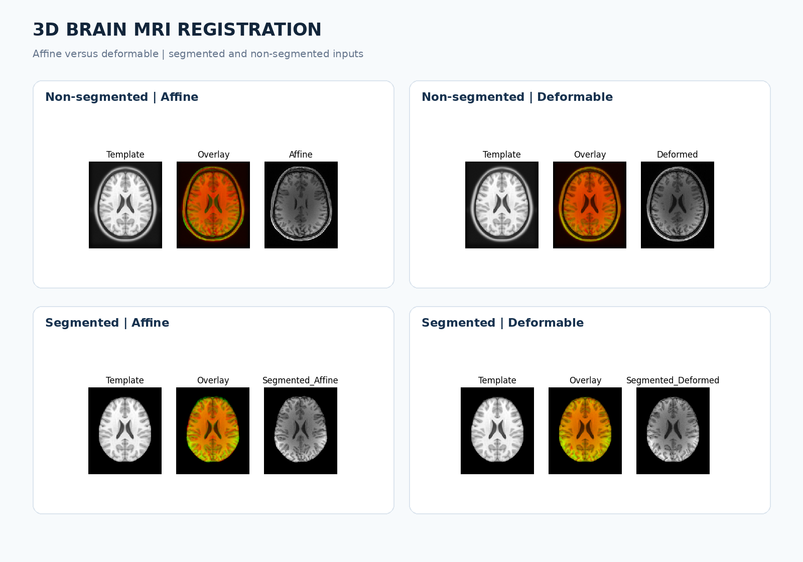
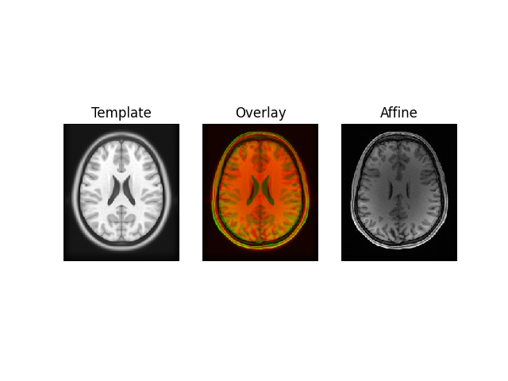
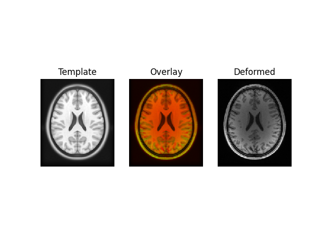
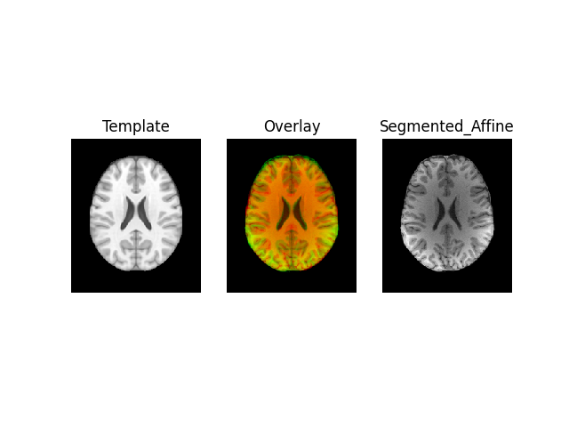
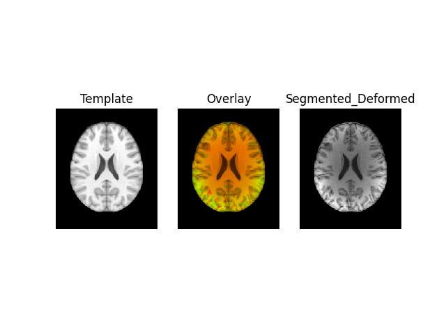
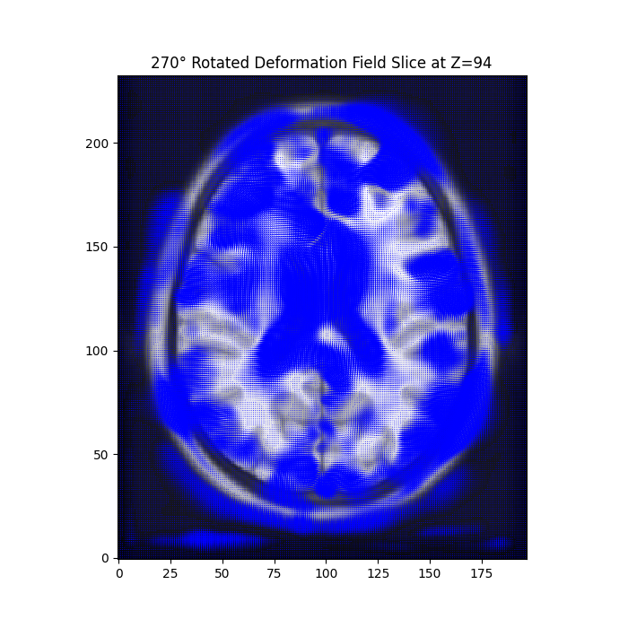
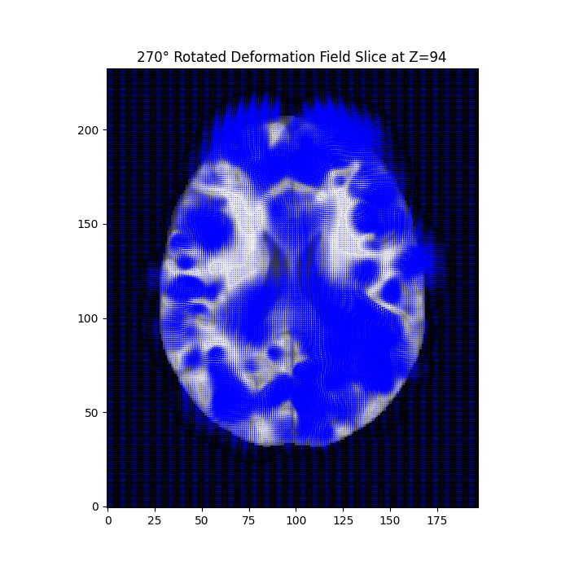

# 3D Brain MRI Registration: Affine vs. Deformable Methods

**Biomedical Engineering · Medical Image Processing · Python / DIPY · 2024**

This university project investigates how to align **3D brain MRI volumes** with a common brain atlas using global affine and local deformable registration. I implemented separate workflows for **non-segmented** and **segmented** brain images, compared the registered volumes across anatomical views, and visualized their deformation fields.

> **Academic demonstration only.** The workflow is not clinically validated. The comparison below describes the original laboratory results; the registration pipeline has not been rerun after minor source-code corrections made for this public version.



## What I built

1. **Affine registration**: align each moving patient MRI to its fixed reference atlas using a multi-resolution optimization pipeline (translation → rigid → full affine transformation) with a mutual-information metric.
2. **Deformable registration**: refine alignment using DIPY's **SymmetricDiffeomorphicRegistration** and a cross-correlation similarity metric.
3. **Segmented vs. non-segmented analysis**: apply both methods to original intensity images and their segmented counterparts.
4. **Visual and quantitative evaluation**: compare atlas overlays in axial, coronal and sagittal views; inspect deformation fields; calculate Dice similarity and mean squared error.

## Main observations

The original laboratory report found that **deformable registration improved local alignment** around visible brain structures, particularly the lateral ventricles. The segmented-image comparison reported the following measurements:

| Reported measure — segmented volumes | Affine | Deformable |
| --- | ---: | ---: |
| Dice similarity coefficient | 0.91 | 0.9841 |
| Mean squared error (MSE) | 84,557.47 | 103,722.98 |

The metrics **do not agree on one universal winner**: the deformable approach obtained greater reported mask overlap, while affine alignment had a smaller reported MSE. The Dice calculation in the source code uses voxels greater than zero as foreground, rather than independently validated anatomical regions; these scores should therefore be interpreted as experimental results, not clinical segmentation accuracy. The original code also had an affine-output saving issue corrected in the public script and notebook versions. **The reported numbers were not recomputed with the corrected files.**

## Visual results

### Whole-volume (non-segmented) registration

| Affine | Deformable |
| --- | --- |
|  |  |

### Segmented-volume registration

| Affine | Deformable |
| --- | --- |
|  |  |

### Deformation-field visualizations

| Non-segmented | Segmented |
| --- | --- |
|  |  |

These figures are selected from the original experiment and show different processing stages. They are qualitative examples, not quantitative proof of correct anatomy registration.

## Project structure

```text
brain-mri-3d-registration/
├── README.md
├── requirements.txt
├── .gitignore
├── scripts/
│   ├── nonsegmented_registration.py
│   └── segmented_registration.py
├── notebooks/
│   ├── lab6_nonsegmented.ipynb
│   └── lab6_segmented.ipynb
├── assets/figures/                # selected outputs
├── report/lab6_report.pdf         # original academic report
└── docs/portfolio-preview.html    # standalone portfolio-page example
```

## Reproducing the experiment

This repository intentionally **does not redistribute** the supplied patient scans, atlas volumes, or generated `.nii` datasets, because permission to publish those files has not been established. You will need separately obtained, appropriately licensed study data before running the scripts.

1. Install Python and dependencies, ideally in a new virtual environment.

   ```bash
   python -m venv .venv
   # Windows PowerShell:
   .venv\Scripts\Activate.ps1
   pip install -r requirements.txt
   ```

2. Place these input files in the **repository root**, preserving their names:

   ```text
   original_patient.nii.gz
   atlas_not_segmented.nii
   segmented_patient.nii.gz
   atlas_segmented.nii
   ```

3. From the repository root, run:

   ```bash
   python scripts/nonsegmented_registration.py
   python scripts/segmented_registration.py
   ```

   Registration on full MRI volumes can be memory- and time-intensive. Scripts depend on DIPY behavior compatible with the original lab environment; newer library releases may require adaptations.

The notebooks provide a more interactive walk-through. Open them in Jupyter or VS Code and run from the repository root, where the NIfTI input files are expected.

## Dependencies and techniques

- **Python**: NumPy, Matplotlib, NiBabel, DIPY, SciPy, scikit-learn
- **Image formats**: NIfTI (`.nii`, `.nii.gz`)
- **Algorithms**: mutual-information-driven affine optimization, symmetric diffeomorphic registration, cross-correlation metric
- **Evaluation**: visual atlas overlays, displacement-field analysis, Dice overlap and MSE

## Revisions and limitations

The original student files have been preserved in the academic report. In the public Python scripts and notebooks, I corrected two implementation issues:

- Save **the actual final affine-transformed data**, not the intermediate rigid result, using the **fixed atlas geometry** for the saved NIfTI.
- Save the **3D displacement-magnitude image in atlas voxel order**, without transposing its dimensions. This is a magnitude image, **not** the full 4D vector field.

These corrections have been syntax-checked but **not run against the full original MRI volumes**. The screenshots and metrics in the report reflect the student's original experiment and have not been regenerated.

### Publication note

MRI volumes and any images derived from them should be published only if the underlying dataset's license or authorization permits redistribution. The selected preview figures and the student-authored report remain subject to that verification. No private patient identifiers have been intentionally included in the repository.

---

*Medical Image Processing — Biomedical Engineering academic portfolio project (2024).*
